# CYD Home Solar Monitor

A home energy-flow display for the 2.8″ ESP32 "Cheap Yellow Display" (ESP32-2432S028R). It shows solar generation, house demand, grid import/export and battery power and charge as live, animated flows.

It is built for a **SolarEdge inverter with a battery and energy meter**, read by **Home Assistant** through the **[SolarEdge Modbus Multi](https://github.com/WillCodeForCats/solaredge-modbus-multi)** integration. It was developed on a SolarEdge SE6000 with an LG 9.8 kWh battery. The panel shows Home Assistant's sensors, so without that setup it can only run in demo mode.

Source release `0.9.0` (local preparation; publication pending) · Latest published record `0.8.0` · [Install in your browser](https://anthonyjclarke.github.io/CYD-Home_Solar_Monitor/) · [Handbook](docs/index.html) · [Changelog](CHANGELOG.md)

**Centre flow (light, default)**

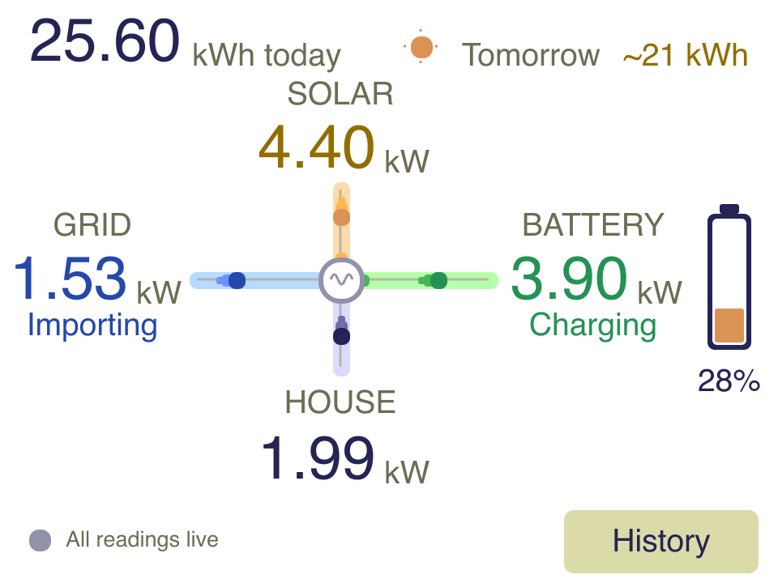

**Cards (dark)**

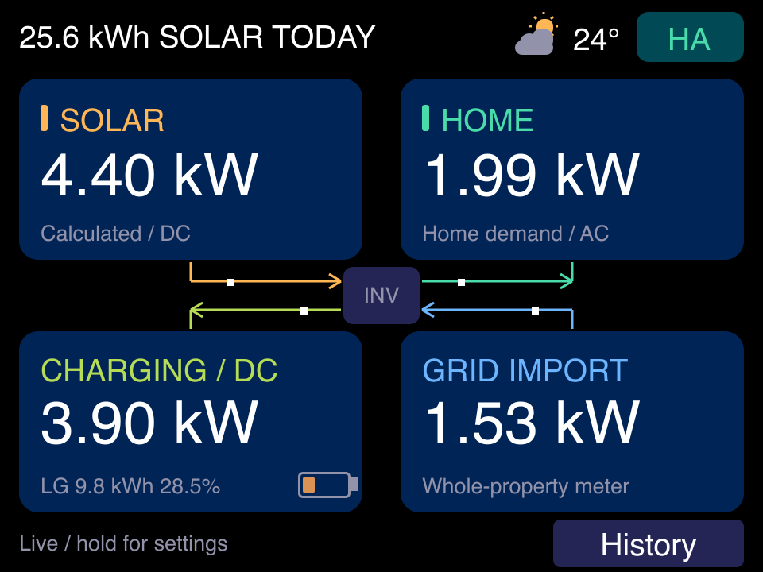

All panel previews and browser captures below use synthetic demonstration data. They were refreshed for 0.9.0 on 5 November 2026; none is a measurement from the owner’s system. See the [release verification record](docs/RELEASE_0.9.0.md) for checks and outstanding hardware work.

Both layouts show the same readings. Switch between them in the browser under **Settings → Display → Layout**.

---

## Features

- **Two panel layouts.** Centre flow (light, the default) has the four flows meeting at the inverter, with comets travelling along each pipe the way power flows. Cards (dark) shows the same readings as four cards. Choose either in the web UI under **Settings → Display → Layout**.
- **24-hour history.** Five-minute snapshots of actual power, battery level, optional totals and weather, shared by the panel and browser. LittleFS checkpoints every 15 minutes retain completed saves across reboots; missing readings stay gaps. Tap **History** or hold the panel longer than two seconds for Settings.
- **Battery at a glance.** A gauge filled to the state of energy turns amber below 50% and red below 20%. The status line says when it's a good time to use power.
- **Optional extras:** today's solar kWh, tomorrow's solar forecast, and weather from Open-Meteo for a location you choose.
- **Browser dashboard** at `http://solar.local/`, covering:
    - live tiles and an animated flow diagram;
    - shared, persistent 24-hour history charts;
    - every setting, diagnostics and firmware update;
    - this project's handbook, served by the panel itself at `/guide/`.
- **Honest readings.** Stale or missing values grey out and keep their last number instead of dropping to zero, and the status line gives the reason.
- **Quality of life:**
    - a boot screen and matching serial startup report with Wi-Fi, IP, signal, actual HA readiness, history restore and clock status;
    - scheduled dimming, display off and morning turn-on;
    - touch calibration;
    - POSIX timezone set from the browser.

The monitor never talks to the inverter. Home Assistant keeps its existing connection (here, SolarEdge Modbus Multi), and the CYD reads entity states from Home Assistant's local REST API every few seconds.

---

## What you need

### Energy system and Home Assistant

| Item                   | Requirement                                  |
| :--------------------- | :------------------------------------------- |
| SolarEdge inverter     | Modbus TCP turned on in SetApp (port 1502)   |
| Battery                | On that inverter; reports DC power and SoE   |
| SolarEdge energy meter | At the grid connection (import/export)       |
| Home Assistant         | Same LAN as the panel                        |
| SolarEdge Modbus Multi | Installed from HACS, meters and batteries on |
| House power sensor     | A template helper (in the handbook)          |
| Access token           | A long-lived token from your HA profile      |
| Optional               | Forecast.Solar or Solcast; daily solar kWh   |

The inverter takes one Modbus client at a time. Home Assistant is that client, which is why the panel reads Home Assistant and never the inverter. The cloud SolarEdge integration isn't enough: it updates every 15 minutes and has no battery power.

### Hardware

| Item            | Notes                                         |
| :-------------- | :-------------------------------------------- |
| ESP32-2432S028R | 2.8″ CYD: ILI9341, resistive touch, micro-USB |
| USB data cable  | Charge-only cables aren't detected            |
| 5 V USB supply  | 1 A or better, to run it permanently          |
| Chrome or Edge  | Desktop browser, for the web installer        |
| 2.4 GHz Wi-Fi   | The ESP32 can't join 5 GHz-only networks      |

No soldering or wiring. The board costs about US$10–15; the [CYD community repository](https://github.com/witnessmenow/ESP32-Cheap-Yellow-Display) describes it, where to buy it and printable cases. Newer two-USB-port boards use a different display controller and are untested.

---

## Install

1. Open **[anthonyjclarke.github.io/CYD-Home_Solar_Monitor](https://anthonyjclarke.github.io/CYD-Home_Solar_Monitor/)** in desktop Chrome or Edge.
2. Plug the CYD in with a USB **data** cable, pick the board and click **Connect**.
3. On a new board, choose **Install** and agree to erase. Then use **Configure Wi-Fi** to send your network details over USB.
4. On a board already running this firmware, the page offers **Update** instead, which keeps Wi-Fi, settings and calibration.

Each [release](https://github.com/anthonyjclarke/CYD-Home_Solar_Monitor/releases) also carries `*-firmware.bin`, for the device page's **Firmware update**, and `*-merged.bin`, for a clean USB install, which overwrites NVS settings. This is not a full-chip erase.

The installer behavior above is the intended contract; fresh install and updates from both app slots still need the real-board checks in `docs/WEB_INSTALLER.md`.

Without the browser installer, the panel opens a `CYD-Solar-xxxx` hotspot after 20 seconds with no Wi-Fi. Its password is the device code shown on screen.

---

## Setup

You need a Home Assistant **long-lived access token**: Profile → Security → Long-lived access tokens.

1. Browse to `http://solar.local/`, or hold the panel longer than two seconds to see its IP address. There is no login, so keep the device on a trusted home network.
2. Under **Settings → Home Assistant**, enter the Home Assistant URL and the token, then save.
3. Under **Settings → Entities**, check the six power sensors. Five come from Modbus Multi with its default names. The household sensor is a template you create; the handbook gives it, along with a true daily-solar sensor (inverter AC energy overcounts with a battery).
4. Optionally:
    - search for your town under **Location & weather**;
    - add the daily-solar and forecast sensors;
    - choose a layout.

| Reading       | Default entity                           | Sign in Home Assistant |
| :------------ | :--------------------------------------- | :--------------------- |
| Inverter AC   | `sensor.solaredge_i1_ac_power`           | diagnostic only        |
| Household     | `sensor.home_power_usage`                | positive               |
| Grid          | `sensor.solaredge_i1_m1_ac_power`        | + export, – import     |
| Battery       | `sensor.solaredge_i1_b1_dc_power`        | + charge, – discharge  |
| Battery level | `sensor.solaredge_i1_b1_state_of_energy` | %                      |
| Inverter DC   | `sensor.solaredge_i1_dc_power`           | signed DC power        |

Solar is calculated as inverter DC less battery discharge, never from inverter AC, following the [SolarEdge Modbus Multi](https://github.com/WillCodeForCats/solaredge-modbus-multi/wiki/Template-Sensors-for-Power-and-Energy#single-inverter-single-battery-single-import--export-meter) single-battery template.

The **[handbook](docs/index.html)** covers the rest in detail:

- every setting;
- an annotated guide to the display and its states;
- how freshness is judged;
- serial diagnostics, with a saved log level under **Settings → Display → Serial debug**;
- troubleshooting.

The panel serves the same handbook at `http://solar.local/guide/`, so help works without internet. You can also open `docs/index.html` from a local clone. The handbook is embedded during the firmware build; updating it on a running panel requires a firmware update.

---

## Browser dashboard

Open `http://solar.local/` from any phone, tablet or computer on your home network. The page follows your light or dark setting and refreshes every three seconds. Live readings and the rolling 24-hour chart come from the panel. History survives browser reloads and device restarts through the latest valid checkpoint. Live status refreshes every three seconds; history refreshes every minute. Optional place search contacts Open-Meteo from the browser, and optional device weather and NTP need external services.

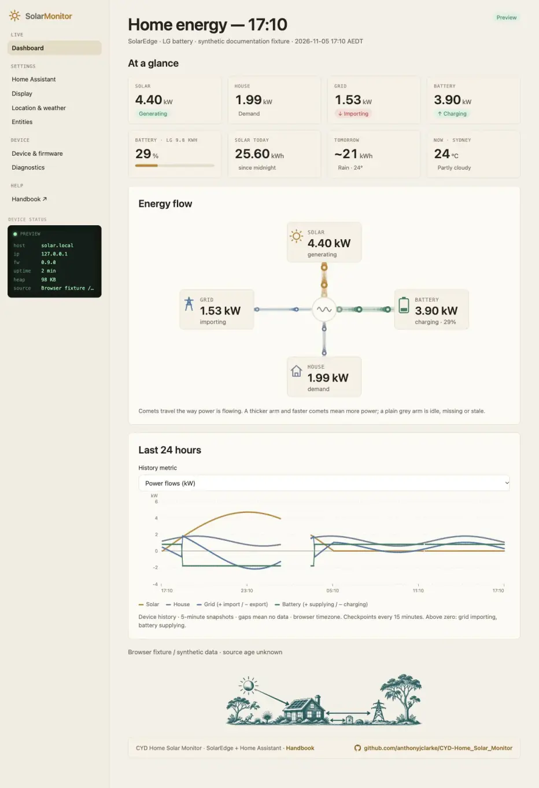

The dashboard reads from top to bottom.

**At a glance.** Eight tiles give the live picture:

- solar, house, grid and battery power;
- the battery level, with a bar coloured like the panel's gauge;
- solar energy so far today and tomorrow's forecast;
- the current weather.

The pills say which way power is going: green when you're exporting or charging, red when importing. Down the left, the **Device status** panel shows whether readings are live, plus the address, firmware, uptime and free memory.

**Energy flow.** Each reading joins the inverter by a pipe, and comets travel the way power is flowing. A thicker pipe and faster comets mean more power, and a plain grey pipe means that reading is idle or stale. It's the quickest way to see where your solar is going: into the house, into the battery, or out to the grid.

If your phone or computer has **Reduce Motion** turned on (on an iPhone: Settings → Accessibility → Motion), the comets stay still. That's deliberate: they sit near the end of each pipe, pointing the way power flows.

**Last 24 hours.** Solar, house, grid and battery share a signed kW chart. Above zero, grid is importing and battery is supplying; below zero, grid is exporting and battery is charging. Gaps are never replaced by zero. Five-minute snapshots are instantaneous readings, not interval averages or energy estimates. Chart labels use the browser timezone; the CYD uses its configured timezone.

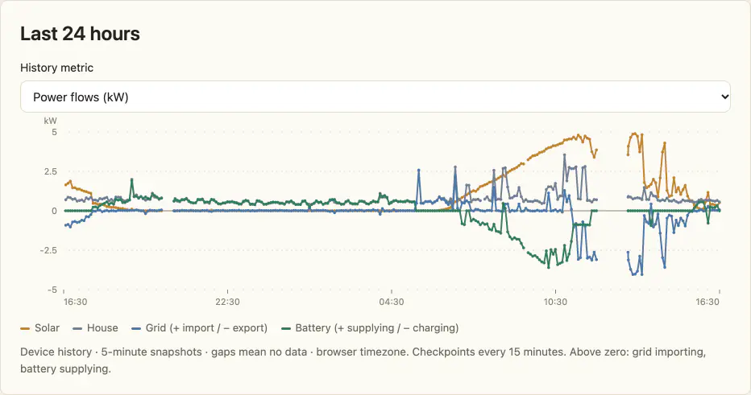

Pick a single metric from **History metric** to see it on its own scale: battery %, diagnostic inverter AC/DC, kWh totals or temperature, with sampled min, average and max. Raw weather codes are categorical points without averages or connecting lines.

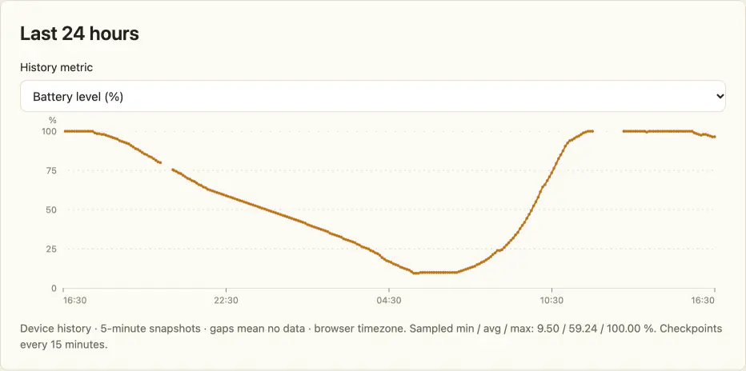

At the foot of the page there's a small illustration of the system, with Australian plants and wildlife, then links to the handbook and to this repository.

---

## 24-hour history on the panel

The panel keeps the same history as the browser. Tap **History** on the flow screen, choose a tab (Solar, Home, Grid, Batt, Level) or use **Prev/Next** for every other metric, and tap **Home** to return. Each view shows the latest value and how many of the 288 five-minute slots hold data. Numeric metrics also show sampled min, average and max; raw weather codes are categorical points. History follows the layout's theme and stays available while offline.

Since **History** now sits where the Settings button used to be, hold anywhere for more than two seconds to open Settings. Release, then hold again in Settings to calibrate. The first night-time touch only wakes the screen.

**Solar, with a gap.**

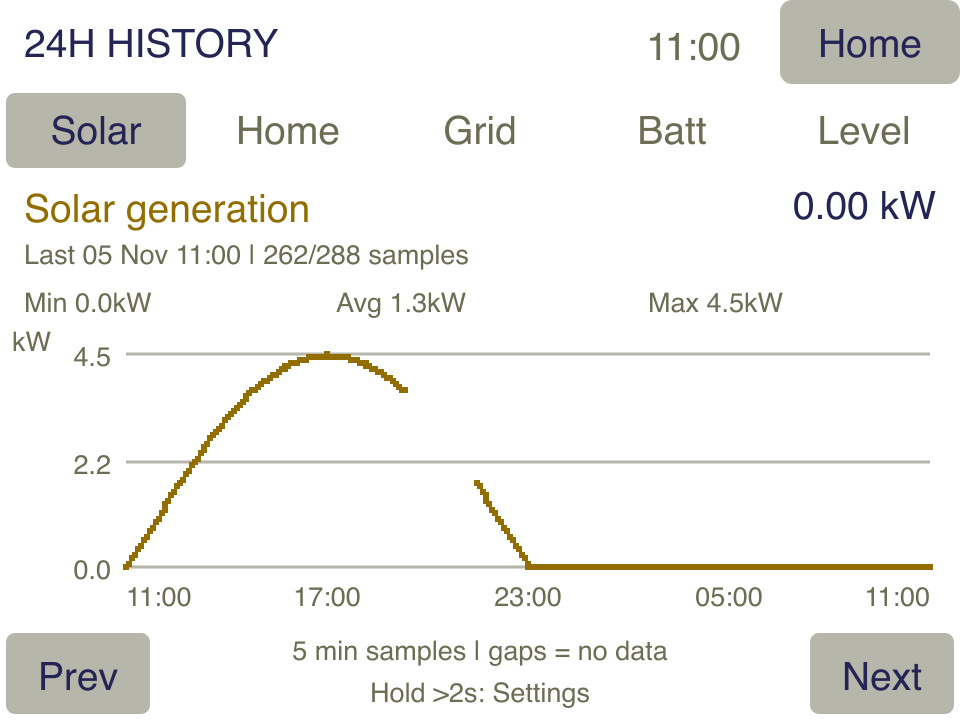

**Battery: + supplying, − charging.**

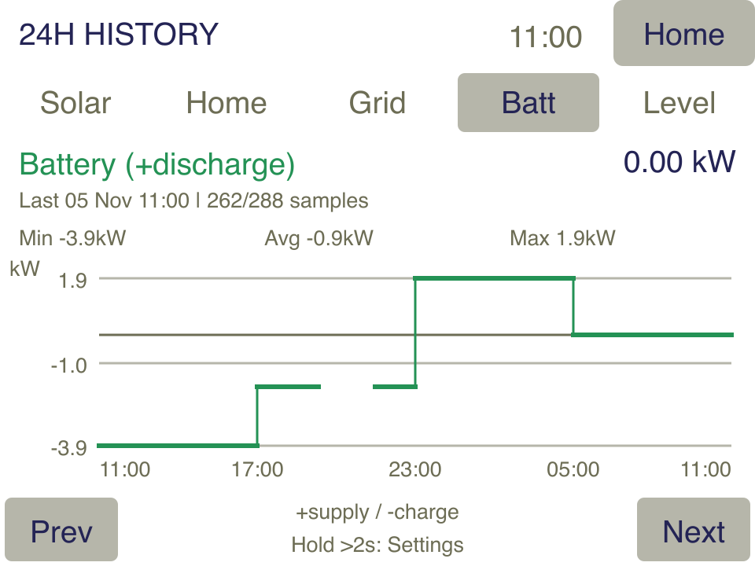

**Dark theme (Cards layout).**

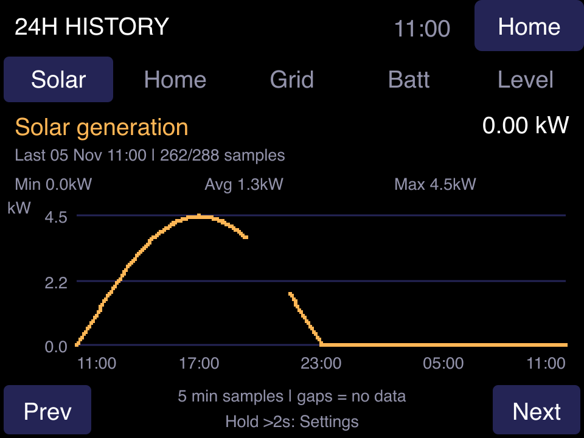

**Other metrics via Prev/Next.**

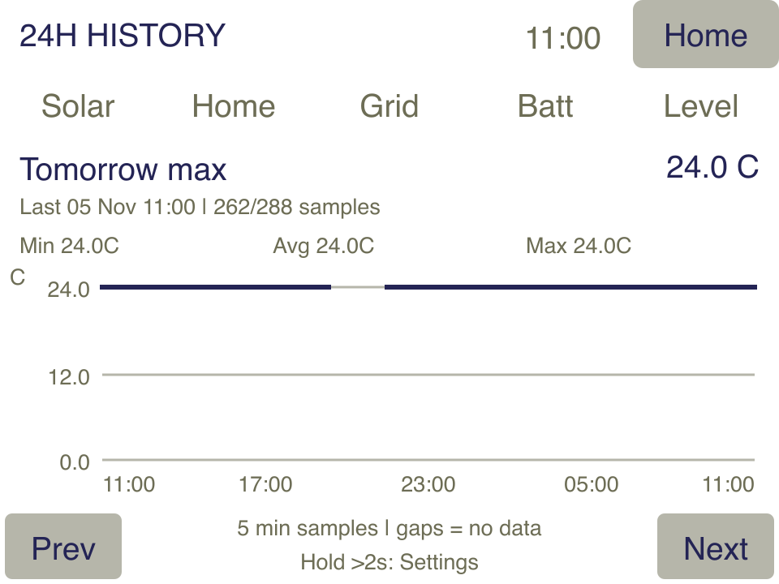

Straight after install, or after changing the Home Assistant URL, entities or location, history starts empty and fills as the panel runs:

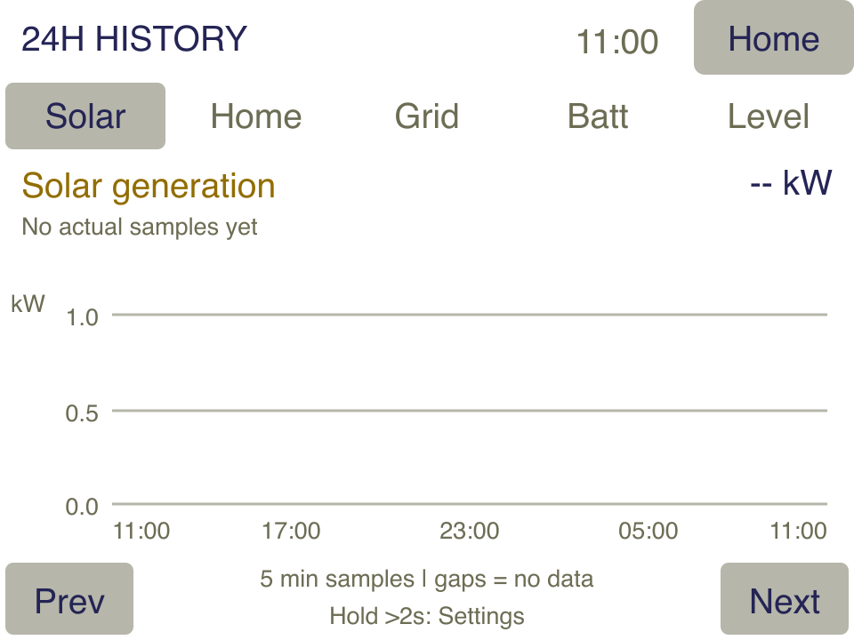

These panel pictures use synthetic data, not readings from a real system.

A sudden outage can lose up to roughly 15 minutes of new samples when storage is healthy. No samples are created without a synchronized device clock or from demo mode. Changing the HA URL, entity mappings, totals or coordinates clears history to avoid mixing sources. Settings, labels and timezone changes otherwise retain it. Corrupt storage is not automatically erased; a storage warning indicates RAM-only collection. See [history implementation and validation](docs/HISTORY_IMPLEMENTATION.md) for storage details and pending real-board tests.

---

## Settings and diagnostics

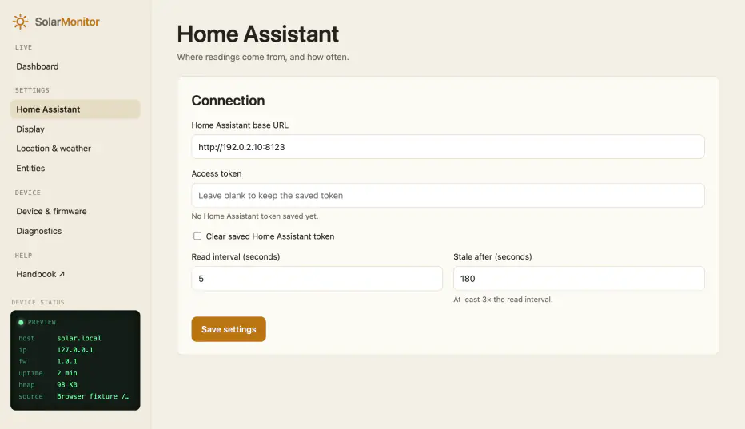

**Settings.** Settings are split across four pages, and **Save settings** on any page saves them all:

- **Home Assistant:** the URL, access token and read interval;
- **Display:** layout, brightness, battery label, serial debug level, night-mode scheduling and demo mode;
- **Location & weather:** search for your town to set the weather location and timezone;
- **Entities:** the six power sensors, the optional daily and forecast sensors, and an HTTPS certificate.

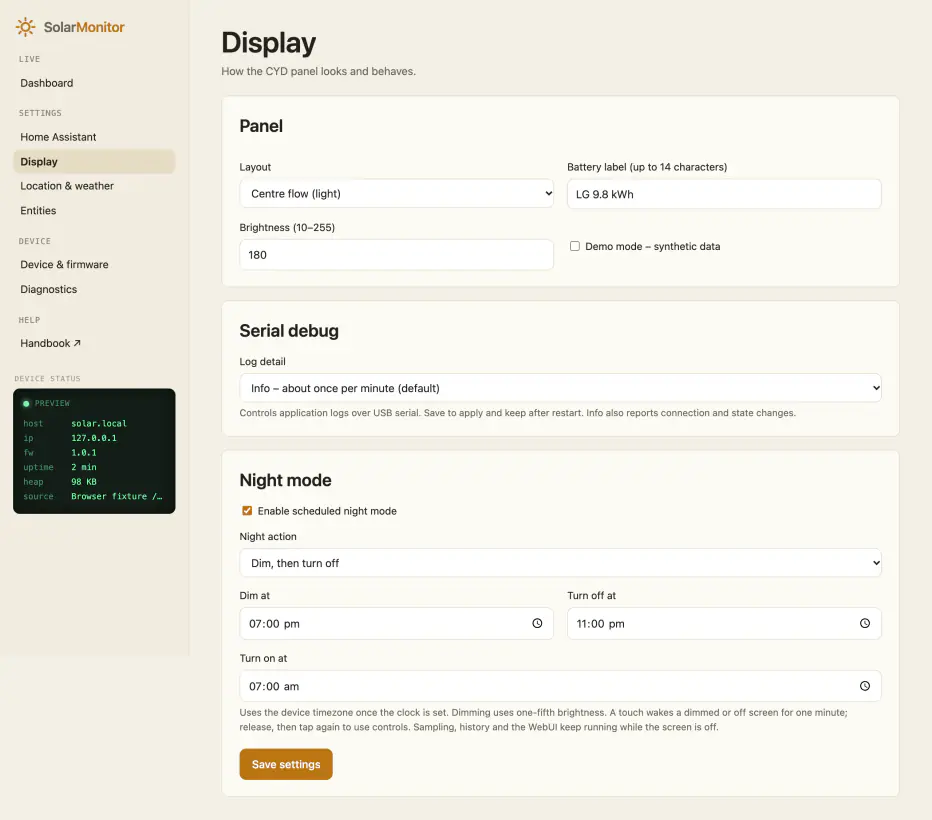

Under **Display → Night mode**, choose **Dim only**, **Turn off only**, or **Dim, then turn off** and set the relevant times plus **Turn on at**. Times use the device timezone with minute precision and can span midnight. In staged mode, the off time must fall between dim and morning on. Existing saved hour schedules migrate to dim-only mode.

Dimming uses one-fifth of normal brightness (minimum 5). A touch wakes a dimmed or off panel for one minute and is consumed; release and touch again to use controls. The first minute after restart stays awake, and no night action runs until the clock is set. Turning off means zero backlight and paused screen rendering; HA polling, history, serial, WebUI and OTA keep running. Equal start/on times disable a single-action schedule.

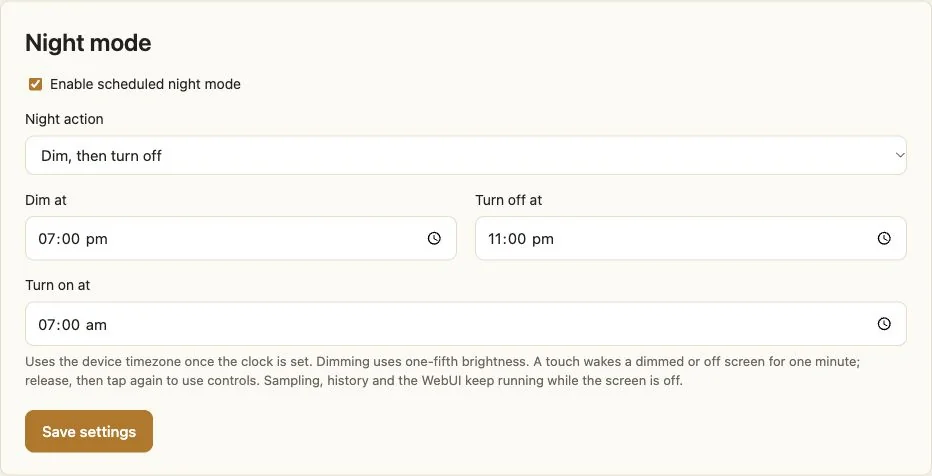

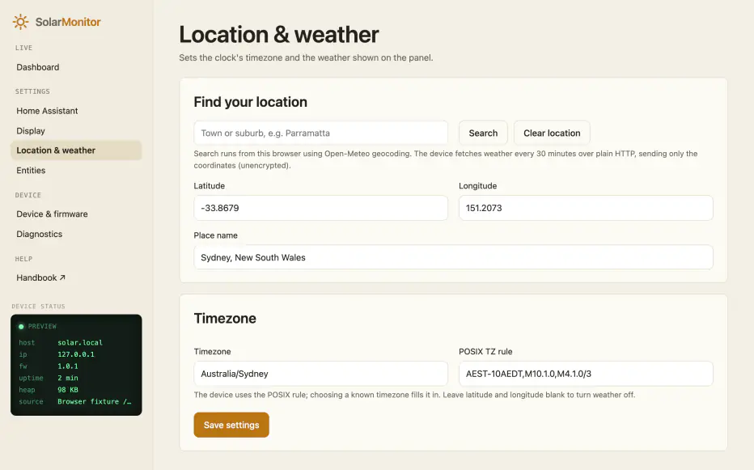

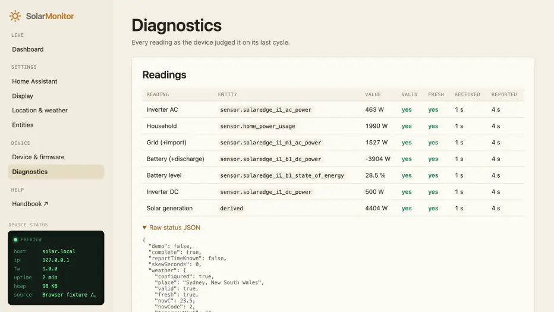

**Diagnostics.** Every reading is listed with its Home Assistant entity, value, whether it's valid, and how old it is. This is the first place to look when a value on the panel is grey. **Device & firmware** has restart, Wi-Fi reset and firmware upload.

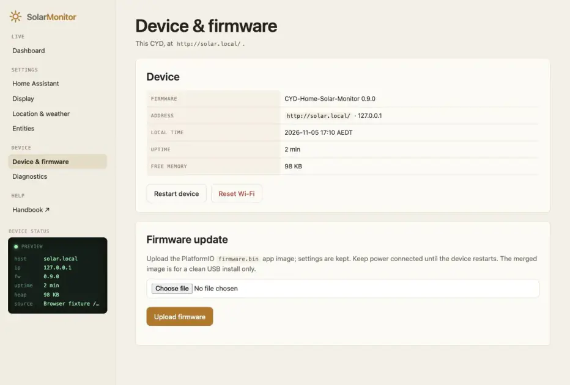

There's no login, by design for a trusted home network. Anyone who can reach the panel can read its telemetry and non-secret settings, change settings or upload firmware. The request header guard blocks ordinary cross-site browser mutations; it does not authenticate LAN clients. The device page uses HTTP, including when you submit the token. Keep it on a trusted LAN. The token is stored in device NVS and is never returned by the API; the editable public CA certificate is returned. No flash encryption is configured by this project.

---

## Building

From the repository root, with PlatformIO Core, Python 3 and a C++17 compiler installed:

```bash
python3 tools/check_host.py
pio run -e cyd28
```

The only environment is `cyd28` (`espressif32@6.12.0`, Arduino core 2.0.17, C++17). Host checks cover energy, history, serial levels, boot diagnostics and night scheduling, and render 22 SVG previews in `docs/images/` plus thirteen PNGs when `rsvg-convert` is installed. With the pinned ArduinoJson headers installed they also test the real history serializer and configuration/API logic using host stand-ins. Run `node tests/test_web_history.js` and `node tests/test_web_settings.js` for browser regressions. These checks do not verify physical HTTP transport, NVS, TLS or OTA.

`python3 tools/preview_server.py` serves the dashboard with synthetic data at `http://127.0.0.1:8765`. Settings are in memory only; the fixture includes the handbook and images, but has no reboot or upload endpoints. Use synthetic values only.

The firmware build embeds the handbook and web assets, then writes `firmware.bin`, `firmware-merged.bin` and `flash_parts.json` under `.pio/build/cyd28/`. The app must fit the 1,835,008-byte OTA slot. Use `firmware.bin` for a settings-preserving app update; the merged image is for a clean USB write at `0x0` and overwrites NVS.

To upload to an authorized connected board:

```bash
pio run -e cyd28 -t upload --upload-port /dev/cu.usbserial-10
pio device monitor -b 115200 --port /dev/cu.usbserial-10
```

At default **Info**, serial startup output first reports firmware/reset/app slot and each initialization stage, then mirrors the CYD boot rows as they change. It finishes when services are ready or after 60 seconds; skipping the CYD boot screen does not cancel the serial checks. No startup line contains the access token, Wi-Fi password or device code.

The default **Info** level reports routine polling and health about once a minute. Choose **Verbose** for every-poll detail, **Warnings and errors**, **Errors only**, or **Off** under **Settings → Display → Serial debug**, then save. The level applies immediately and survives restart. Off controls application logs; bootloader or library output and USB provisioning responses may still appear.

Replace the example serial port with yours. No credentials are needed to compile. Publish release images through CI, never a locally configured build. The local GitHub Actions workflow installs pinned JSON headers and runs host integration/model checks and both browser regression suites before calling the shared [cyd-web-installer](https://github.com/anthonyjclarke/cyd-web-installer) workflow; the release convention is a matching `v*` tag on `main`.

See [AGENTS.md](AGENTS.md) for architecture and contribution rules, [development reference](docs/DEVELOPMENT.md) for APIs, storage and checks, [current roadmap](docs/REVIEW_AND_ROADMAP.md) for remaining work, and [hardware validation](docs/HARDWARE_VALIDATION.md) and [installer checks](docs/WEB_INSTALLER.md) for physical tests still owed.

---

## Acknowledgements

Thank you to the projects this one builds on:

- **Energy and Home Assistant:**
    - [SolarEdge Modbus Multi](https://github.com/WillCodeForCats/solaredge-modbus-multi) by WillCodeForCats, plus its [template-sensor wiki](https://github.com/WillCodeForCats/solaredge-modbus-multi/wiki/Template-Sensors-for-Power-and-Energy);
    - [Home Assistant](https://www.home-assistant.io/) and [HACS](https://hacs.xyz/);
    - [Forecast.Solar](https://www.home-assistant.io/integrations/forecast_solar/) and [Solcast](https://github.com/BJReplay/ha-solcast-solar).
- **Weather:** [Open-Meteo](https://open-meteo.com/). Weather data by Open-Meteo.com, licensed [CC BY 4.0](https://creativecommons.org/licenses/by/4.0/).
- **Hardware:** the [ESP32 Cheap Yellow Display](https://github.com/witnessmenow/ESP32-Cheap-Yellow-Display) community, led by Brian Lough.
- **Firmware libraries:**
    - [Arduino core for ESP32](https://github.com/espressif/arduino-esp32) and [PlatformIO](https://platformio.org/);
    - [TFT_eSPI](https://github.com/Bodmer/TFT_eSPI) by Bodmer;
    - [XPT2046_Touchscreen](https://github.com/PaulStoffregen/XPT2046_Touchscreen) by Paul Stoffregen;
    - [WiFiManager](https://github.com/tzapu/WiFiManager) by tzapu;
    - [ArduinoJson](https://arduinojson.org/) by Benoît Blanchon;
    - [Improv-WiFi-Library](https://github.com/jnthas/Improv-WiFi-Library) by jnthas.
- **Installer:** [ESP Web Tools](https://esphome.github.io/esp-web-tools/) and [Improv Wi-Fi](https://www.improv-wifi.com/), through [cyd-web-installer](https://github.com/anthonyjclarke/cyd-web-installer).

The handbook's [appendix](docs/index.html#appendix) lists what each one is used for.

SolarEdge, LG and Home Assistant are trademarks of their owners. This project isn't affiliated with or endorsed by them.

MIT licensed – see [LICENSE](LICENSE).
