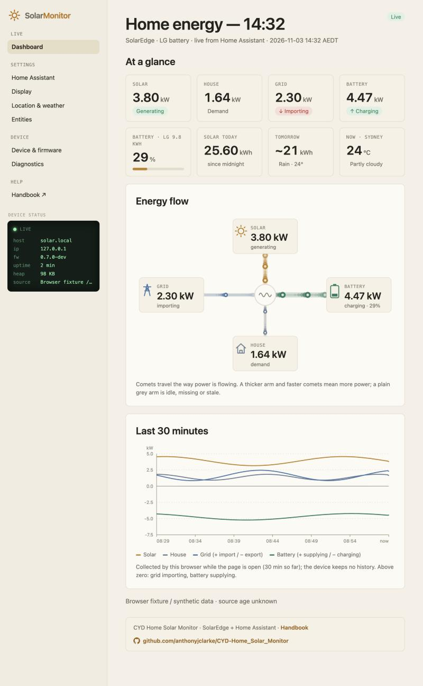
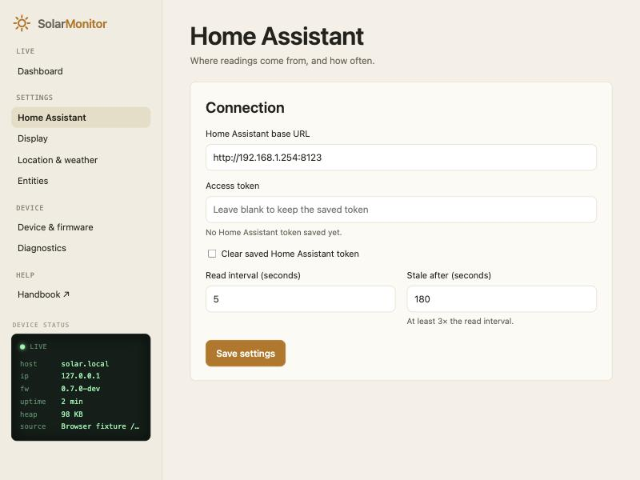
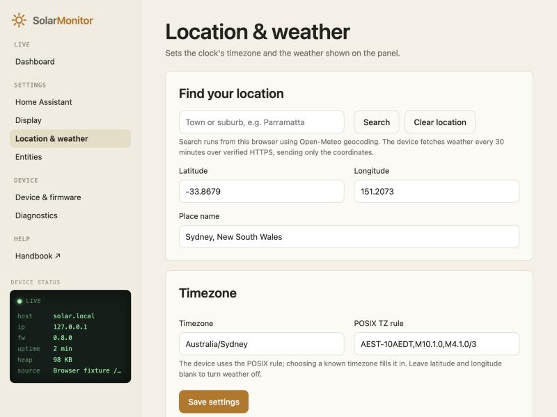
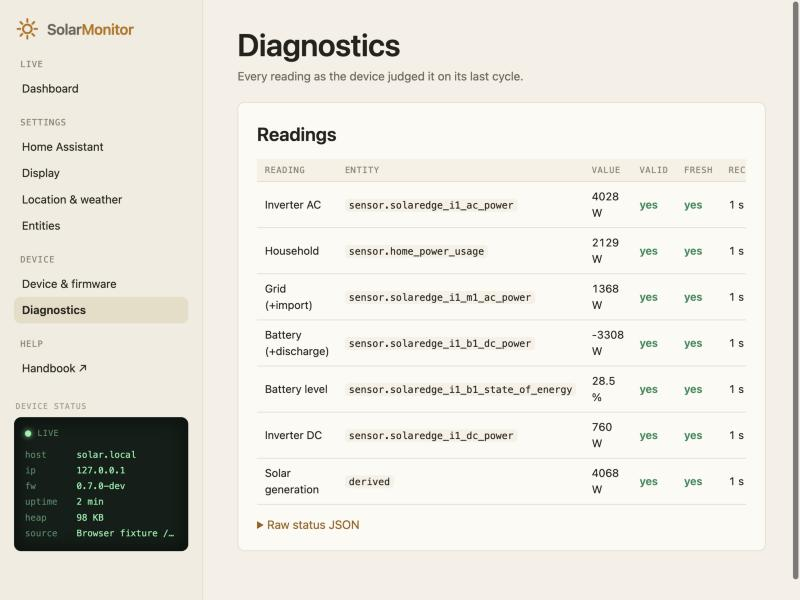

# CYD Home Solar Monitor

A home energy-flow display for the 2.8″ ESP32 "Cheap Yellow Display" (ESP32-2432S028R). It shows solar generation, house demand, grid import/export and battery power and charge as live, animated flows.

It is built for a **SolarEdge inverter with a battery and energy meter**, read by **Home Assistant** through the **[SolarEdge Modbus Multi](https://github.com/WillCodeForCats/solaredge-modbus-multi)** integration. It was developed on a SolarEdge SE6000 with an LG 9.8 kWh battery. The panel shows Home Assistant's sensors, so without that setup it can only run in demo mode.

Version `0.7.0` · [Install in your browser](https://anthonyjclarke.github.io/CYD-Home_Solar_Monitor/) · [Handbook](docs/index.html) · [Changelog](CHANGELOG.md)

| Centre flow (light, default)                                     | Cards (dark)                                     |
|:----------------------------------------------------------------:|:------------------------------------------------:|
|        |     |

Both layouts show the same readings. Switch between them in the browser under **Settings → Display → Layout**.

---

## Features

- **Two panel layouts.** Centre flow (light, the default) has the four flows meeting at the inverter, with moving arrows showing direction. Cards (dark) shows the same readings as four cards. Choose either in the web UI under **Settings → Display → Layout**.
- **Battery at a glance.** A gauge filled to the state of energy turns amber below 50% and red below 20%. The status line says when it's a good time to use power.
- **Optional extras:** today's solar kWh, tomorrow's solar forecast, and weather from Open-Meteo for a location you choose.
- **Browser dashboard** at `http://solar.local/`, covering:
  - live tiles and an animated flow diagram;
  - a 30-minute trend chart;
  - every setting, diagnostics and firmware update.
- **Honest readings.** Stale or missing values grey out and keep their last number instead of dropping to zero, and the status line gives the reason.
- **Quality of life:**
  - a boot screen with the IP address, Wi-Fi signal and Home Assistant host;
  - night dimming;
  - touch calibration;
  - POSIX timezone set from the browser.

The monitor never talks to the inverter. Home Assistant keeps its existing connection (here, SolarEdge Modbus Multi), and the CYD reads entity states from Home Assistant's local REST API every few seconds.

---

## What you need

### Energy system and Home Assistant

| Item                   | Requirement                                   |
|:-----------------------|:----------------------------------------------|
| SolarEdge inverter     | Modbus TCP turned on in SetApp (port 1502)    |
| Battery                | On that inverter; reports DC power and SoE    |
| SolarEdge energy meter | At the grid connection (import/export)        |
| Home Assistant         | Same LAN as the panel                         |
| SolarEdge Modbus Multi | Installed from HACS, meters and batteries on  |
| House power sensor     | A template helper (in the handbook)           |
| Access token           | A long-lived token from your HA profile       |
| Optional               | Forecast.Solar or Solcast; daily solar kWh    |

The inverter takes one Modbus client at a time. Home Assistant is that client, which is why the panel reads Home Assistant and never the inverter. The cloud SolarEdge integration isn't enough: it updates every 15 minutes and has no battery power.

### Hardware

| Item               | Notes                                         |
|:-------------------|:----------------------------------------------|
| ESP32-2432S028R    | 2.8″ CYD: ILI9341, resistive touch, micro-USB |
| USB data cable     | Charge-only cables aren't detected            |
| 5 V USB supply     | 1 A or better, to run it permanently          |
| Chrome or Edge     | Desktop browser, for the web installer        |
| 2.4 GHz Wi-Fi      | The ESP32 can't join 5 GHz-only networks      |

No soldering or wiring. The board costs about US$10–15; the [CYD community repository](https://github.com/witnessmenow/ESP32-Cheap-Yellow-Display) describes it, where to buy it and printable cases. Newer two-USB-port boards use a different display controller and are untested.

---

## Install

1. Open **[anthonyjclarke.github.io/CYD-Home_Solar_Monitor](https://anthonyjclarke.github.io/CYD-Home_Solar_Monitor/)** in desktop Chrome or Edge.
2. Plug the CYD in with a USB **data** cable, pick the board and click **Connect**.
3. On a new board, choose **Install** and agree to erase. Then use **Configure Wi-Fi** to send your network details over USB.
4. On a board already running this firmware, the page offers **Update** instead, which keeps Wi-Fi, settings and calibration.

Each [release](https://github.com/anthonyjclarke/CYD-Home_Solar_Monitor/releases) also carries `*-firmware.bin`, for the device page's **Firmware update**, and `*-merged.bin`, for a clean USB install, which erases all settings.

Without the browser installer, the panel opens a `CYD-Solar-xxxx` hotspot after 20 seconds with no Wi-Fi. Its password is the device code shown on screen.

---

## Setup

You need a Home Assistant **long-lived access token**: Profile → Security → Long-lived access tokens.

1. Browse to `http://solar.local/`, or tap the panel to see its IP address. There is no login, so keep the device on a trusted home network.
2. Under **Settings → Home Assistant**, enter the Home Assistant URL and the token, then save.
3. Under **Settings → Entities**, check the six power sensors. Five come from Modbus Multi with its default names. The household sensor is a template you create; the handbook gives it, along with a true daily-solar sensor (inverter AC energy overcounts with a battery).
4. Optionally:
   - search for your town under **Location & weather**;
   - add the daily-solar and forecast sensors;
   - choose a layout.

| Reading       | Default entity                           | Sign in Home Assistant   |
|:--------------|:-----------------------------------------|:-------------------------|
| Inverter AC   | `sensor.solaredge_i1_ac_power`           | diagnostic only          |
| Household     | `sensor.home_power_usage`                | positive                 |
| Grid          | `sensor.solaredge_i1_m1_ac_power`        | + export, – import       |
| Battery       | `sensor.solaredge_i1_b1_dc_power`        | + charge, – discharge    |
| Battery level | `sensor.solaredge_i1_b1_state_of_energy` | %                        |
| Inverter DC   | `sensor.solaredge_i1_dc_power`           | positive                 |

Solar is calculated as inverter DC less battery discharge, never from inverter AC, following the [SolarEdge Modbus Multi](https://github.com/WillCodeForCats/solaredge-modbus-multi/wiki/Template-Sensors-for-Power-and-Energy#single-inverter-single-battery-single-import--export-meter) single-battery template.

The **[handbook](docs/index.html)** covers the rest in detail:
- every setting;
- an annotated guide to the display and its states;
- how freshness is judged;
- serial diagnostics;
- troubleshooting.

The panel serves the same handbook at `http://solar.local/guide/`, so it works without internet. You can also open it from a local clone.

---

## Browser dashboard

Open `http://solar.local/` from any phone, tablet or computer on your home network. The page follows your light or dark setting and refreshes every three seconds. Nothing is stored in the cloud: the page talks only to the panel.



The dashboard reads from top to bottom.

**At a glance.** Eight tiles give the live picture:
- solar, house, grid and battery power;
- the battery level, with a bar coloured like the panel's gauge;
- solar energy so far today and tomorrow's forecast;
- the current weather.

The pills say which way power is going: green when you're exporting or charging, red when importing. Down the left, the **Device status** panel shows whether readings are live, plus the address, firmware, uptime and free memory.

**Energy flow.** Each reading joins the inverter by a pipe, and comets travel the way power is flowing. A thicker pipe and faster comets mean more power, and a plain grey pipe means that reading is idle or stale. It's the quickest way to see where your solar is going: into the house, into the battery, or out to the grid.

**Last 30 minutes.** Solar, house, grid and battery are charted against clock time. Above the zero line, the grid is importing and the battery supplying; below it, you're exporting and charging. The chart is collected by your browser while the page is open, so it fills from the right. The panel itself keeps no history.

The footer links to the handbook and to this repository.



**Settings.** Settings are split across four pages, and **Save settings** on any page saves them all:
- **Home Assistant:** the URL, access token and read interval;
- **Display:** layout, brightness, battery label, night dimming and demo mode;
- **Location & weather:** search for your town to set the weather location and timezone;
- **Entities:** the six power sensors, the optional daily and forecast sensors, and an HTTPS certificate.





**Diagnostics.** Every reading is listed with its Home Assistant entity, value, whether it's valid, and how old it is. This is the first place to look when a value on the panel is grey. **Device & firmware** has restart, Wi-Fi reset and firmware upload.

There's no login, by design for a trusted home network, so don't expose the panel to the internet or a guest network.

---

## Building

Open the folder in PlatformIO (env `cyd28`, `espressif32@6.12.0`, Arduino core 2.0.17, C++17):

```bash
pio run -t upload
```

`python3 tools/check_host.py` runs the host-side model tests and renders the panel previews in `docs/images/`. `python3 tools/preview_server.py` serves the browser dashboard with synthetic data at `http://127.0.0.1:8765`.

No secrets are compiled in: the token and Wi-Fi live in the device's NVS. Release images are built by GitHub Actions on a `v*` tag, using the shared [cyd-web-installer](https://github.com/anthonyjclarke/cyd-web-installer) workflow. Never publish a local build.

---

## Acknowledgements

Thank you to the projects this one builds on:

- **Energy and Home Assistant:**
  - [SolarEdge Modbus Multi](https://github.com/WillCodeForCats/solaredge-modbus-multi) by WillCodeForCats, plus its [template-sensor wiki](https://github.com/WillCodeForCats/solaredge-modbus-multi/wiki/Template-Sensors-for-Power-and-Energy);
  - [Home Assistant](https://www.home-assistant.io/) and [HACS](https://hacs.xyz/);
  - [Forecast.Solar](https://www.home-assistant.io/integrations/forecast_solar/) and [Solcast](https://github.com/BJReplay/ha-solcast-solar).
- **Weather:** [Open-Meteo](https://open-meteo.com/). Weather data by Open-Meteo.com, licensed [CC BY 4.0](https://creativecommons.org/licenses/by/4.0/).
- **Hardware:** the [ESP32 Cheap Yellow Display](https://github.com/witnessmenow/ESP32-Cheap-Yellow-Display) community, led by Brian Lough.
- **Firmware libraries:**
  - [Arduino core for ESP32](https://github.com/espressif/arduino-esp32) and [PlatformIO](https://platformio.org/);
  - [TFT_eSPI](https://github.com/Bodmer/TFT_eSPI) by Bodmer;
  - [XPT2046_Touchscreen](https://github.com/PaulStoffregen/XPT2046_Touchscreen) by Paul Stoffregen;
  - [WiFiManager](https://github.com/tzapu/WiFiManager) by tzapu;
  - [ArduinoJson](https://arduinojson.org/) by Benoît Blanchon;
  - [Improv-WiFi-Library](https://github.com/jnthas/Improv-WiFi-Library) by jnthas.
- **Installer:** [ESP Web Tools](https://esphome.github.io/esp-web-tools/) and [Improv Wi-Fi](https://www.improv-wifi.com/), through [cyd-web-installer](https://github.com/anthonyjclarke/cyd-web-installer).

The handbook's [appendix](docs/index.html#appendix) lists what each one is used for.

SolarEdge, LG and Home Assistant are trademarks of their owners. This project isn't affiliated with or endorsed by them.

MIT licensed – see [LICENSE](LICENSE).
